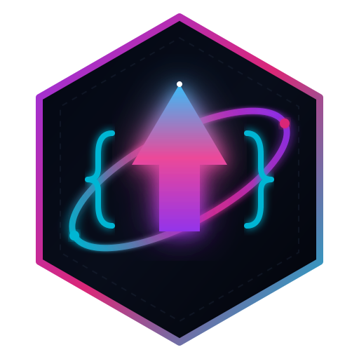

# 🚀 GravKtrl (`com.gravktrl.app`)
### Mobile-to-PC Remote Agent Commander & Terminal Bridge for Google Antigravity

<p align="center">
  
</p>

<p align="center">
  <strong>Control, observe, and steer Google Antigravity AI agents and native PC terminals directly from your smartphone.</strong><br/>
  Zero-typing Wi-Fi auto-discovery • 6-Digit Quick PIN pairing • 2026 Foldable/Flippable UI engine • Standalone Android APK
</p>

---

## ⚡ Overview

**GravKtrl** (`com.gravktrl.app`) bridges the gap between your workstation and your mobile devices. Whether lounging on the couch, commuting over Tailscale VPN, or multitasking across screens, GravKtrl provides real-time oversight of Google Antigravity IDE agent runs, live streaming PC terminal execution, and Git version control.

### System Topology
```
┌─────────────────────────────────┐          ┌──────────────────────────────────┐
│  GravKtrl Mobile Commander App  │  Wi-Fi   │      GravKtrl PC Host Daemon     │
│       (com.gravktrl.app)        │ ◄──────► │       Node.js + TS (:8787)       │
│  Cover • Phone • Flip • Fold    │ Tailscale│  JSON-RPC 2.0 • 256-Bit Token    │
└─────────────────────────────────┘          └──────────────┬───────────────────┘
                                                            │
                            ┌───────────────────────────────┴───────────────────┐
                            ▼                                                   ▼
            ┌───────────────────────────────┐                   ┌───────────────────────────────┐
            │   Google Antigravity IDE      │                   │    Native PC Terminal Engine  │
            │   CDP WebSocket (:9222)       │                   │    PowerShell / Bash PTY      │
            │   DOM Injection + 350ms Poll  │                   │    Destructive Command Guard  │
            │   Fallback: INBOX.md + Clip   │                   │    Git Porcelain Engine       │
            └───────────────────────────────┘                   └───────────────────────────────┘
```

---

## ✨ Features

### 1. 📡 4-Tier Zero-Typing Pairing Engine
- **Wi-Fi Auto-Radar Beacon (`GET /api/discover`):** The PC daemon advertises host metadata with CORS enabled so your phone automatically discovers your computer without typing an IP address.
- **6-Digit Quick Pairing PIN (`POST /api/pair-pin`):** A human-friendly 6-digit PIN (e.g. `482 - 910`) is displayed in the PC terminal on boot. Entering this on your phone automatically exchanges it for the 256-bit cryptographic master token (enforced with a 5 attempts/minute rate limiter).
- **Terminal QR Code:** Instant scan with your phone's camera for zero-config onboarding.
- **Deep Link Handler:** One-tap pairing via `gravktrl://pair?host=<IP>&port=8787&token=<TOKEN>`.

### 2. 📱 Universal 2026 Foldable & Flippable Posture Engine
Built for the newest generation of smartphones, flips, and foldables:
- **`cover-compact` (`< 360px`):** Ultra-condensed HUD for Galaxy Z Fold 8 outer screens and Razr cover displays.
- **`phone-slab` (`360px – 599px`):** Ergonomic 4-tab bottom navigation dock (`Agent`, `Terminal`, `Git & Files`, `Host PC`).
- **`flip-flex` (90° Clamshell Tabletop):**
  - *Top 50%:* Live Antigravity agent thoughts and terminal output stream.
  - *Hinge Safe Bar (28px):* System telemetry divider aligned with the fold crease.
  - *Bottom 50%:* Tactile control pad with a 2×3 1-tap macro grid (`Typecheck`, `Test`, `Build APK`, `ADB Devices`, `Git Status`, `Stop Agent`).
- **`fold-dual` (`600px – 1023px`):** True dual-pane command center (Agent Console on left, dedicated Hinge Crease Buffer in center, Live Terminal & Git Diff on right).
- **`desktop-mission` (`1024px+`):** 3-column panoramic layout for tablets and desktop monitors.
- **Posture Switcher Pill:** Test and override any posture mode on any screen directly from the UI header.

### 3. 🧠 Antigravity IDE Controller (CDP Port 9222 + Clipboard Fallback)
- **Direct DOM Evaluation:** Connects over Chrome DevTools Protocol to inject prompts into Antigravity IDE chat inputs, triggers agent actions, and streams conversation turns every 350ms.
- **Seamless Fallback Queue:** If port 9222 is closed, prompts are automatically staged in the Windows system clipboard (`Set-Clipboard`) and logged to `<workspace>/.antigravity/GRAVKTRL_INBOX.md`.

### 4. 🛡️ Native Terminal Engine & Destructive Command Guard
- Real-time PowerShell / Bash streaming with `stdout` and `stderr` capture.
- **Destructive Safety Gate:** Intercepts high-risk commands (`rm -rf`, `Remove-Item -Recurse`, `rmdir /s`, `format`, `git reset --hard`, `git push --force`) and pauses execution until explicitly confirmed by the operator on mobile.

### 5. 📂 Multi-Workspace Switcher & Git Porcelain Inspector
- Seamlessly bookmark and switch between PC workspaces (`gravktrl`, `omni-tool`, etc.).
- Inspect branch status, staged/modified files, and colorized Git diffs.

---

### Step 1: Windows Desktop 1-Click Setup (Zero-CLI)
You don't need to use the terminal every time! Run the automated shortcut installer once:
```powershell
powershell -ExecutionPolicy Bypass -File scripts\setup-windows-shortcuts.ps1
```
This automatically:
1. **Configures the Antigravity Windows App** in your Start Menu and Desktop to always launch with `--remote-debugging-port=9222` enabled.
2. **Creates a 1-Click Desktop Icon** for `GravKtrl PC Host`.

*Manual Alternative:* Right-click your existing Antigravity shortcut on Windows ➔ **Properties** ➔ In the **Target** field, append ` --remote-debugging-port=9222` at the end ➔ Click **Apply**.

### Step 2: Start the PC Host Daemon
Double-click the **GravKtrl PC Host** icon on your Windows desktop (or run in PowerShell):
```powershell
powershell -ExecutionPolicy Bypass -File scripts\start-gravktrl-pc.ps1
```
The terminal displays your LAN IP, Tailscale IP, ephemeral 6-digit PIN, and an ASCII QR code.

### Step 3: Install Mobile App on Android
- **From GitHub Releases:** Download `app-debug.apk` directly from the [Releases](https://github.com/lagtastic-legends/gravktrl/releases) tab.
- **From Local PC Network:** When the daemon is running, open a browser on your phone and go to:
  ```
  http://<YOUR_PC_LAN_IP>:8787/download-apk
  ```
- **Sideload via ADB:**
  ```powershell
  adb install -r android\app\build\outputs\apk\debug\app-debug.apk
  ```

### Step 3: Connect
1. Launch GravKtrl on your device.
2. Tap **Auto-Detect PC** on your Wi-Fi network.
3. Enter the **6-digit PIN** displayed in your PC terminal.
4. You are now commanding your workstation!

---

## 🛠️ Tech Stack

- **Mobile App:** Next.js 16 (App Router, Turbopack, `output: "export"`), React 19, Tailwind CSS v4, Lucide Icons, Capacitor 7.
- **PC Daemon:** Node.js, TypeScript (ES2022), `ws` (WebSocket JSON-RPC 2.0), `qrcode-terminal`.
- **Drivers:** Chrome DevTools Protocol (CDP), Native ChildProcess PowerShell PTY, Git Porcelain Engine.
- **Mobile Target:** Android 12L – Android 16 (API 34+), Samsung One UI Foldable & Flip extensions.

---

## 🧪 Verification & Testing

Run the automated 9-stage end-to-end integration test suite:
```bash
npx tsx scripts/test-gravktrl-e2e.ts
```
The test suite boots an ephemeral daemon, verifies the HTTP discovery beacon, executes the 6-digit PIN exchange, confirms 256-bit authentication, runs streaming terminal commands, tests the destructive safety gate interception, inspects Git diffs, and validates the CDP fallback queue.

---

## 📄 License

MIT © [lagtastic-legends](https://github.com/lagtastic-legends)
